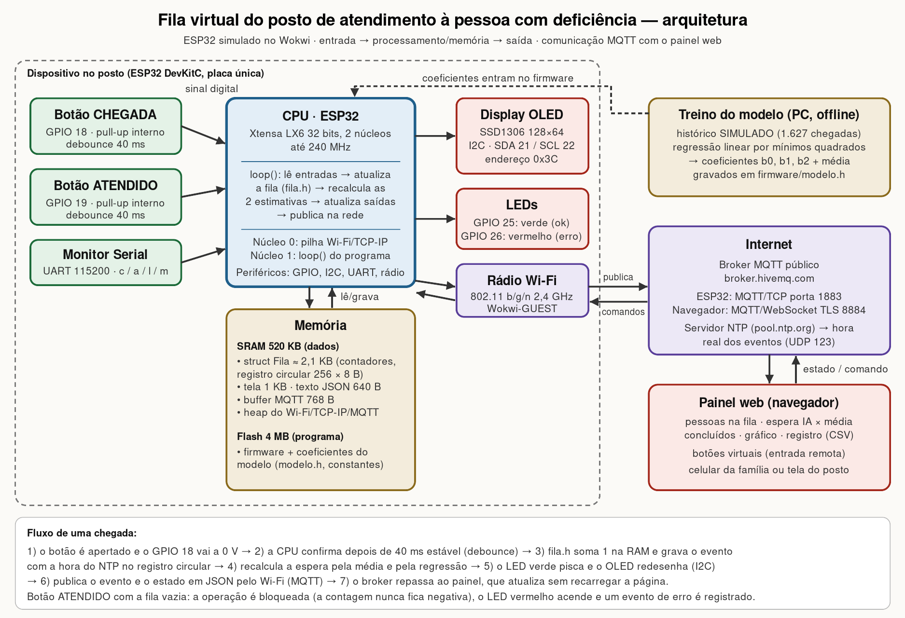

# Relatório técnico · Sistema Inteligente de Gerenciamento de Filas Virtuais

**GS 2026.2 · Computer Organization and Architecture · turma 1CCR · projeto integrador Citizen Assist AI (Mapiii)**

| Nome | RM |
|---|---|
| Gabriel Botelho Romão | 570589 |
| Thor Ferreira Camargo | 569543 |

> **Antes de entregar:** escrever a conclusão da dupla (último parágrafo, marcado com [PREENCHER]) e exportar este arquivo para PDF/DOCX se o Portal pedir. Ver [PENDENCIAS.md](../PENDENCIAS.md).

---

## 1. Problema e cenário

Em postos de atendimento, quem chega não sabe quanto vai esperar. Para pessoas com deficiência isso pesa mais: muitas dependem de transporte adaptado agendado (como o Atende+), de um acompanhante ou têm dificuldade de ficar horas na sala de espera. O cenário escolhido é a **fila de um posto de atendimento à pessoa com deficiência**, o mesmo público do assistente Mapiii, projeto principal da dupla nesta GS.

O protótipo registra quem chega e quem foi atendido, mostra a fila no próprio posto e publica pela internet o tamanho da fila e uma **previsão de espera**, que a família pode ver pelo celular antes de sair de casa.

## 2. Arquitetura (Etapa 1)

Fonte editável: [`arquitetura.svg`](arquitetura.svg).

| Bloco | Componente | Papel |
|---|---|---|
| Processamento | **ESP32** (DevKitC v4, simulado no Wokwi) | executa o programa: lê entradas, atualiza a fila, calcula as previsões, aciona as saídas e a rede |
| Memória | SRAM interna de 520 KB · flash SPI externa de 4 MB | SRAM: variáveis (fila, registro de eventos, buffers, pilha Wi-Fi). Flash: programa e constantes (coeficientes do modelo) |
| Entrada | 2 botões (GPIO 18 e 19), Monitor Serial (UART), botões virtuais do painel (via rede) | registrar chegada e conclusão de atendimento |
| Saída | display OLED SSD1306 128×64 (I2C), LEDs verde e vermelho (GPIO 25 e 26), painel web | mostrar fila, espera e confirmação/erro de cada operação |
| Comunicação | rádio Wi-Fi 802.11 b/g/n → MQTT (broker público) · NTP | enviar o estado ao painel, receber comandos, obter a hora real |

**Fluxo de informação de uma chegada:**

1. O botão liga o GPIO 18 ao GND: o pino, que fica em nível alto pelo resistor de pull-up interno, vai a 0 V.
2. A CPU lê o pino a cada volta do `loop()` (varredura, ou *polling*) e só aceita a mudança depois de 40 ms estável (**debounce**), porque o contato mecânico "quica" e geraria várias contagens.
3. A função `fila_chegada` (em `fila.h`) incrementa o contador na **SRAM** e grava um evento de 8 bytes no **registro circular**, com o horário obtido do servidor NTP.
4. A CPU recalcula as duas estimativas de espera (seção 4).
5. **Saídas locais:** o LED verde pisca e o OLED é redesenhado. O desenho é feito num buffer de 1 KB na RAM e enviado pelo barramento I2C.
6. **Rede:** o evento e o estado completo são formatados em JSON e publicados por MQTT sobre TCP/IP, pelo rádio Wi-Fi.
7. O broker repassa a mensagem ao navegador (MQTT sobre WebSocket com TLS). O painel atualiza os números sem recarregar a página.

O caminho inverso também existe: um botão virtual do painel publica `chegada` ou `atendido` no tópico de comando, o ESP32 recebe e **valida na placa** (a regra da fila fica num lugar só) e responde com o novo estado.

## 3. Implementação da fila virtual (Etapa 2)

| Requisito | Como foi feito |
|---|---|
| Registrar chegada por botão | botão verde CHEGADA (GPIO 18) → `fila_chegada()` |
| Registrar conclusão por outro botão | botão azul ATENDIDO (GPIO 19) → `fila_atendido()` |
| Atualizar automaticamente quem aguarda | contador `aguardando` atualizado a cada operação; OLED redesenhado 10×/s; estado publicado a cada mudança e a cada 5 s |
| Impedir contagem negativa e operações inválidas | `fila_atendido()` com fila 0 é **recusado**: o contador não muda, o LED vermelho acende, o OLED mostra "Fila vazia!" e fica gravado um evento `erro_fila_vazia`. Chegada acima de 99 também é recusada (`erro_fila_cheia`). O contador é `uint8_t` e sem essa trava daria a volta para 255 |
| Exibir o total na fila | OLED (número grande) e painel |
| Registrar eventos e horários | registro circular de 256 eventos `{instante, seq, tipo, fila}` na RAM. Cada evento também vai ao painel, que mostra a tabela e exporta em CSV. Tecla `l` no Monitor Serial lista o registro |

A lógica fica em [`firmware/fila.h`](../firmware/fila.h), escrita em C++ sem dependência do Arduino. O **mesmo arquivo** roda na placa e nos testes do PC ([`testes/teste_fila.cpp`](../testes/teste_fila.cpp)), então o que foi testado é o que roda no ESP32.

**Medição do tempo de atendimento:** um atendimento começa quando a pessoa chega com a fila vazia, ou quando a anterior é concluída, e termina no botão ATENDIDO. A diferença é medida com `millis()`, em subtração sem sinal, para funcionar mesmo quando o contador dá a volta (a cada ~49 dias).

**Modo demonstração:** no vídeo os botões são apertados com segundos de intervalo. A constante `FATOR_TEMPO = 60` faz 1 s de placa contar como 1 min de posto, para os números ficarem na escala real de um atendimento (minutos). Num posto de verdade, usar `FATOR_TEMPO = 1`. O painel avisa quando o modo está ligado.

## 4. Previsão inteligente de espera (Etapa 3)

**Dados:** `dados/historico_simulado.csv`, **simulados** por [`ia/gerar_historico.py`](../ia/gerar_historico.py) com semente fixa (o enunciado permite dados simulados identificados). A simulação reproduz 30 dias de um posto (8h às 17h, um atendente) com chegadas aleatórias mais frequentes nos picos e atendimentos mais demorados no pico. Total de 1.627 chegadas; para cada uma ficam registrados a fila encontrada, a média dos últimos 5 atendimentos e a espera real.

**Os dois métodos** (para quem chega e encontra `fila` pessoas):

| | Fórmula | De onde vêm os números |
|---|---|---|
| Convencional | `espera = fila × média histórica` | média de todos os atendimentos do treino (6,24 min), atualizada na placa a cada atendimento medido |
| IA: regressão linear múltipla | `espera = b0 + b1·fila + b2·(fila × média dos últimos 5)` | coeficientes por **mínimos quadrados** (equações normais resolvidas por eliminação de Gauss, escritas à mão em [`ia/treinar_regressao.py`](../ia/treinar_regressao.py)) |

Treino com os dias 1 a 22 e teste com os dias 23 a 30, que o modelo nunca viu:

| Grupo de teste | n | Erro médio (MAE) convencional | MAE IA | RMSE conv. | RMSE IA |
|---|---:|---:|---:|---:|---:|
| todas as chegadas | 426 | 2,48 min | **1,99 min** | 4,09 | **3,49** |
| quem encontrou fila ≥ 3 | 119 | 4,77 min | **4,34 min** | 6,54 | **5,86** |

Coeficientes obtidos: b0 = −2,008 · b1 = 4,929 · b2 = 0,188 (detalhes em [`ia/resultados.md`](../ia/resultados.md)).

**Interpretação.** A regressão erra cerca de **20% menos**. O ganho vem principalmente de corrigir um viés do método convencional: ele conta a pessoa que já está sendo atendida como se faltasse o atendimento inteiro dela. A regressão aprendeu um custo menor por pessoa (b1 < média) e um desconto fixo (b0 < 0). O termo do ritmo recente (b2 > 0) faz a IA aumentar a previsão quando os últimos atendimentos estão lentos, o que a média histórica não percebe. O ganho é moderado porque a fila simulada é simples. Com dados reais o modelo precisaria ser retreinado.

**Na placa:** o treino é feito no PC e gera [`firmware/modelo.h`](../firmware/modelo.h) com os coeficientes como constantes, gravadas na flash. A previsão no ESP32 custa 3 multiplicações e 2 somas em ponto flutuante, quase nada para a CPU, que tem unidade de ponto flutuante de precisão simples. A média dos últimos 5 atendimentos é mantida num vetor circular de 5 posições. As duas previsões são recalculadas a cada evento e aparecem lado a lado no OLED e no painel.

## 5. Comunicação e visualização (Etapa 4)

| Tópico MQTT (prefixo `fiap-gs2026/mapiii-fila/<posto>/`) | Quem publica | Conteúdo |
|---|---|---|
| `estado` (mensagem retida) | ESP32, a cada mudança e a cada 5 s | fila, chegadas, concluídos, recusas, espera convencional e IA, médias, último evento, memória livre, RSSI, tempo ligado |
| `evento` | ESP32, a cada operação | `{seq, tipo, fila, instante, origem}` (origem: botão, painel ou serial) |
| `comando` | painel (botões virtuais) | `chegada` ou `atendido` |

**Painel** ([`painel/index.html`](../painel/index.html)), uma página só, sem servidor próprio:

- mostra as pessoas na fila, a espera estimada (IA e média, lado a lado) e os atendimentos concluídos;
- traz um gráfico da fila no tempo, o registro de eventos com exportação em CSV e botões virtuais;
- indica a conexão: "Posto online", ou "Posto sem enviar dados há N s" quando passam 15 s sem mensagem;
- é acessível: contraste nos temas claro e escuro, botões de 48 px, `aria-live` nos números, foco visível e uso por teclado.

**Por que MQTT:** é publicar/assinar, leve (cabeçalho de 2 bytes) e feito para dispositivos pequenos. A placa não precisa ser um servidor web, o que economizaria RAM mas exigiria abrir porta e IP fixo. A mensagem `estado` é **retida**: quem abre o painel recebe na hora o último estado, sem esperar o próximo evento.

## 6. Análise da arquitetura computacional (Etapa 5)

### 6.1 Processador

| Característica | ESP32 (família ESP32-D0WD, placa DevKitC v4) |
|---|---|
| Arquitetura | **Xtensa LX6** de 32 bits (Tensilica/Cadence), RISC, Harvard modificada: barramentos separados para instruções (IRAM/flash em cache) e dados (DRAM) |
| Núcleos e clock | **2 núcleos** (PRO_CPU e APP_CPU), até **240 MHz** |
| Ponto flutuante | FPU de precisão simples (`float`), usada na previsão |
| Memória interna | 520 KB de SRAM · 448 KB de ROM (boot e funções básicas) |
| Memória externa | flash SPI de 4 MB; o programa roda direto dela (XIP), através de cache |
| E/S | 34 GPIOs, I2C, SPI, UART, ADC, PWM… |
| Rede | Wi-Fi 802.11 b/g/n (2,4 GHz) e Bluetooth no mesmo chip |
| Medido na placa (Wokwi, 17/11/2026) | `Chip: ESP32-D0WDQ6-V3 rev 300, 2 nucleo(s), 240 MHz` |

No Arduino-ESP32, o FreeRTOS divide o trabalho: a pilha Wi-Fi/TCP-IP roda no **núcleo 0** e o `loop()` do programa no **núcleo 1**. Por isso a rede não trava a leitura dos botões e vice-versa. O `delay(5)` no fim do `loop()` libera a CPU para as outras tarefas.

### 6.2 Organização e estimativa de uso da memória

Estimativa a partir do código (`sizeof` conferido no teste do PC):

| Item | Onde | Tamanho |
|---|---|---:|
| `struct Fila` (contadores, médias, registro 256 × 8 B) | SRAM, estática (.bss) | 2.108 B |
| Texto JSON de saída | SRAM, estática | 640 B |
| Nomes dos 3 tópicos | SRAM, estática | 288 B |
| Estados dos botões, LEDs, mensagem | SRAM, estática | ≈ 60 B |
| Buffer da tela (128 × 64 / 8) | SRAM, heap (alocado por `tela.begin`) | 1.024 B |
| Buffer do MQTT (`setBufferSize`) | SRAM, heap | 768 B |
| **Subtotal do nosso programa** | | **≈ 4,9 KB** |
| Pilha Wi-Fi + TCP/IP (lwIP) + cliente MQTT | SRAM, heap | dezenas de KB (medido abaixo) |
| Programa + bibliotecas + coeficientes | flash | **934 KB** (medido) |

**Medido na placa** (Wokwi, 17/11/2026, relatório impresso no boot, logo após conectar o Wi-Fi):

| Medida | Valor |
|---|---|
| Heap total / livre / menor livre já registrado | 322.532 B / 219.844 B / 217.116 B |
| Maior bloco contínuo livre | 110.580 B |
| Heap livre com MQTT conectado e operando (campo `heap_livre` do painel) | ≈ 215.600 B |
| Sobra mínima da pilha do `loop()` | 5.792 B (de 8 KB) |
| Flash: chip / programa | 4.096 KB / 934 KB |

(O simulador informa 0 KB de "espaço livre para programa"; é uma limitação do Wokwi, que não emula a tabela de partições. Numa placa real o valor aparece.) A pilha de rede + bibliotecas consome cerca de 100 KB do heap (322 KB − 220 KB), e os dados do nosso programa, cerca de 5 KB.

Leitura: os dados do nosso programa (≈ 5 KB) são cerca de **1% da SRAM**. Quem mais consome RAM é a pilha de rede. Sobra memória para aumentar bastante o registro de eventos: cada 1.000 eventos a mais custam 8 KB.

### 6.3 Entrada, processamento e saída

O `loop()` é um ciclo de **varredura** (entrada → processamento → saída), repetido centenas de vezes por segundo:

| Fase | O que acontece | Custo aproximado |
|---|---|---|
| Entrada | `digitalRead` dos 2 botões + debounce; leitura do buffer da UART; `mqtt.loop()` entrega comandos recebidos | microssegundos |
| Processamento | regras da fila (comparações e somas de inteiros) e previsão (3 multiplicações em `float`) | microssegundos |
| Saída | LEDs (`digitalWrite`); redesenho do OLED; publicação MQTT | OLED: 1.024 B por I2C ≈ 25 ms a 400 kHz por quadro |

O item mais caro é a tela. Na primeira versão, o OLED era redesenhado 10 vezes por segundo, o que ocupa cerca de 25% do tempo do núcleo 1 só enviando pixels pelo I2C. No teste no Wokwi isso deixou a simulação lenta (~3% da velocidade real). Mudamos para **redesenhar só quando algo muda** (evento, aviso que expira ou mudança de conexão), e a velocidade da simulação subiu para ~24%. É um exemplo prático de como uma operação de E/S cara compete pela CPU. Mesmo na versão antiga nenhum aperto se perdia, porque um aperto humano dura mais de 100 ms e o debounce precisa de 40 ms estáveis. Varredura foi escolhida em vez de interrupção por ser mais simples de explicar e suficiente nessa escala. Com muitos botões ou sinais rápidos, a interrupção seria melhor.

### 6.4 Comunicação entre dispositivos e protocolos

| Ligação | Protocolo | Detalhes |
|---|---|---|
| Botões → ESP32 | sinal digital (GPIO) | nível lógico 3,3 V; pull-up interno; ativo em 0 |
| ESP32 → OLED | **I2C** | 2 fios (SDA 21, SCL 22), endereço 0x3C, síncrono, mestre-escravo |
| ESP32 ↔ PC | **UART** serial | 115200 bps, 8N1 (Monitor Serial) |
| ESP32 ↔ roteador | **Wi-Fi 802.11 b/g/n** | 2,4 GHz; no Wokwi, rede `Wokwi-GUEST` |
| ESP32 ↔ broker | **MQTT 3.1.1 sobre TCP/IP**, porta 1883 | QoS 0, mensagem de estado retida; cliente PubSubClient |
| Navegador ↔ broker | **MQTT sobre WebSocket com TLS** (wss, porta 8884) | biblioteca mqtt.js; o navegador não abre TCP puro |
| ESP32 → servidor de hora | **NTP sobre UDP**, porta 123 | horário de Brasília (UTC−3) para os eventos |

### 6.5 Limitações de desempenho, memória e conectividade

| Limitação | Efeito | O que fizemos / como melhorar |
|---|---|---|
| Registro de eventos na RAM (256) | eventos antigos são sobrescritos; tudo se perde se a placa reiniciar | o painel guarda os últimos 200 e exporta CSV. Melhoria: gravar resumos na flash (NVS/LittleFS), com cuidado com o desgaste |
| Wi-Fi cai | o painel para de atualizar | a fila **continua funcionando** no posto (botões, OLED e LEDs não dependem da rede); a placa tenta reconectar a cada 5 s sem travar os botões; o OLED mostra "offline"; o painel avisa "sem dados há N s". Eventos feitos offline não são reenviados (ficam no registro local, tecla `l`) |
| MQTT QoS 0 | uma mensagem pode se perder | o estado completo é republicado a cada 5 s, então o painel se corrige sozinho. Melhoria: QoS 1 |
| Keep-alive do MQTT | se a placa ficar sem falar com o broker além do prazo, a conexão cai | keep-alive de 60 s (o padrão de 15 s derrubou a conexão na simulação lenta); reconexão automática a cada 5 s |
| Broker público, sem senha | qualquer um que souber o tópico pode ler ou enviar comandos | aceitável num protótipo. Num posto real: broker próprio com usuário, senha e TLS também no ESP32 |
| NTP indisponível | eventos sem hora real | a placa usa segundos desde o boot e o painel mostra "boot + N s" |
| Desenho da tela no I2C | ≈ 25 ms de CPU por quadro | redesenho só quando algo muda (feito depois do teste no Wokwi) |
| Um contador para "na fila" | não separa quem espera de quem está sendo atendido | mesmo critério nos dados de treino, então a previsão continua coerente |
| Modelo treinado com dados simulados | a precisão real é desconhecida | o painel avisa; com dados reais, retreinar com `ia/treinar_regressao.py` |

## 7. Testes e resultados

Detalhes e evidências em [`testes.md`](testes.md). Resumo:

| Teste | Como | Resultado |
|---|---|---|
| Lógica da fila (4 testes mínimos + limites) | `make test`: 39 verificações em C++ com AddressSanitizer | 39/39 ✅ |
| Coerência firmware × simulador | `make coerencia`: mesma sequência no C++ e no Python | idênticos ✅ |
| Comunicação ponta a ponta | simulador → broker público → painel no navegador, mais o botão virtual voltando | ✅ (17/11/2026) |
| Os 4 testes mínimos no Wokwi, com a placa e o painel publicado | roteiro e prints em `testes.md` | ✅ 4/4 + 3 extras (17/11/2026) |

## 8. Como executar

Projeto no Wokwi: https://wokwi.com/projects/480979792844066817 · Painel: https://gabrielroma0.github.io/GS2-COA/painel/ · Detalhes e plano B no [README](../README.md).

## 9. Conclusão

O protótipo mostra o caminho completo de um sistema computacional: sinais elétricos dos botões viram dados na memória, são processados pela CPU (regras e previsão), voltam ao mundo físico pelo display e pelos LEDs e saem pela rede até o navegador. A previsão por regressão superou a média histórica nos dados de teste, e as limitações de memória e de conectividade foram tratadas para a fila nunca parar no posto. **[PREENCHER: 2–3 frases da dupla sobre o que aprenderam.]**
